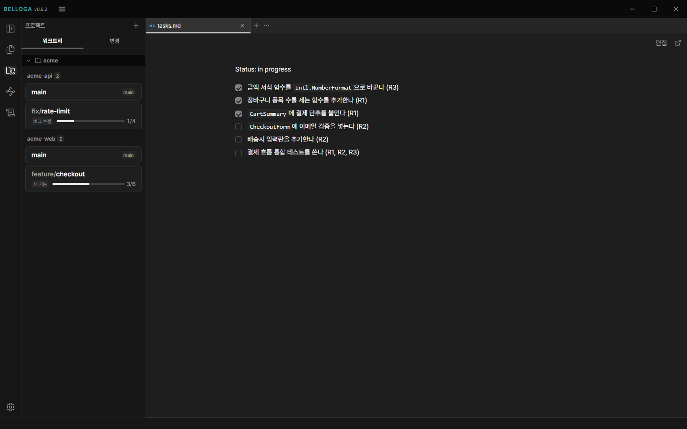
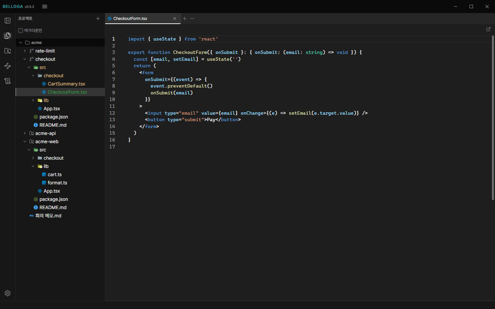
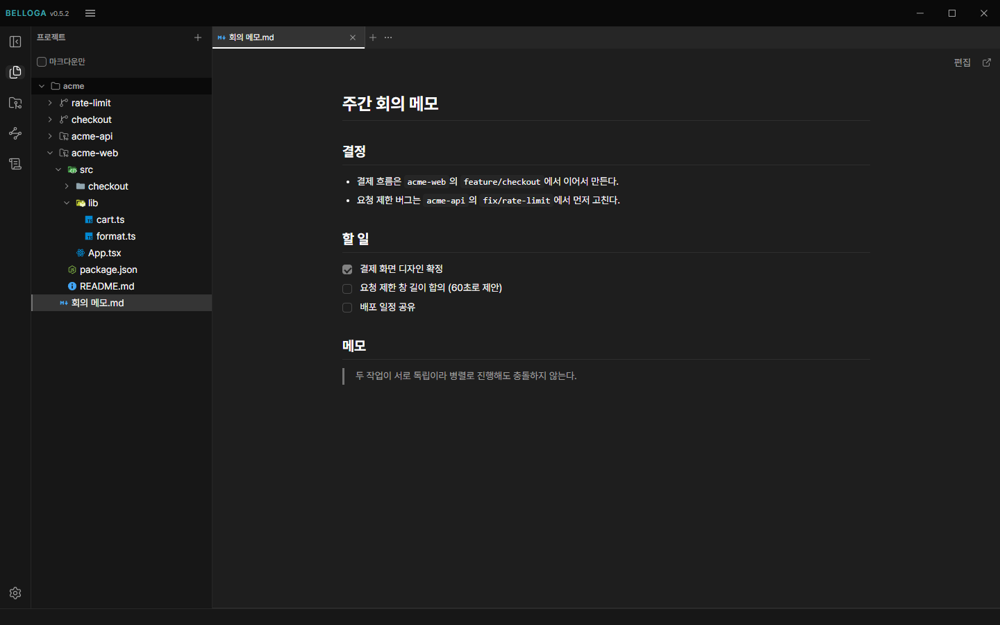
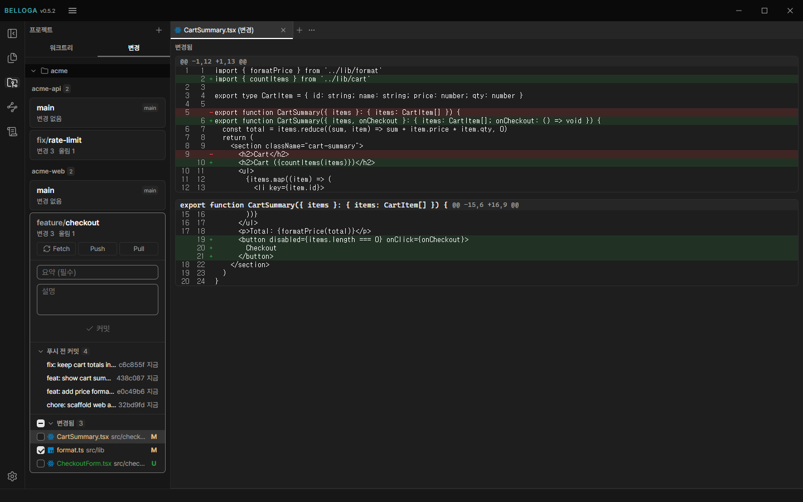

# Belloga



## 1. 프로젝트 개요 (Project Overview)

> 저장소는 비공개입니다. 소개와 사용법은 [belloga.com](https://belloga.com)에 있습니다.

### Belloga: 에이전트 개발 환경을 한 앱으로 모은 데스크톱 앱과 계획 문서 동기화 API

Claude Code로 개발하다 보면 터미널, 에디터, 마크다운 노트, git 클라이언트를 동시에 띄워 두게 됩니다. 창을 오가는 일이 귀찮아서, 에이전트 세션과 코드, 노트, diff를 한 앱에서 다루는 Electron 데스크톱 앱 Belloga를 만들기 시작했습니다.

쓰다 보니 반복되는 일이 하나 더 보였습니다. 세션을 열 때마다 브랜치별 작업 계획(`requirements.md`, `design.md`, `tasks.md`)과 규칙을 에이전트에게 챙겨 주는 일입니다. 이 과정(하네스)도 앱이 대신하도록 넣었습니다. 계획 문서는 저장소를 오염시키지 않으려고 일부러 저장소 밖(`~/.belloga/plans`)에 두었습니다.

그런데 그 선택 때문에 새로운 문제가 생겼습니다. 계획 문서는 git으로 옮길 수 없어서, 데스크톱과 노트북을 오가면 코드는 따라오지만 계획은 따라오지 않았습니다. 이 문제를 풀려고 GitHub 로그인과 **계획 문서 동기화 API**(belloga-api)를 만들었고, 이 프로젝트에서 백엔드 관점으로 가장 깊이 설계한 부분입니다.

2026년 9월에 시작해 개발 중이며, 앱, 서버, 인프라, 문서 사이트까지 혼자 설계하고 운영하고 있습니다.

## 2. 시스템 아키텍처 (System Architecture)

- **데스크톱 앱**: Electron(main, preload, renderer)과 React 19. 동기화 엔진은 main 프로세스에서만 돌고, 세션 토큰은 main 밖으로 나가지 않습니다.
- **API 서버**: NestJS 12와 Prisma 7, Supabase Postgres. 문서 내용은 GCS에, 문서별 현재 상태는 Postgres에 둡니다.
- **트래픽과 배포**: Cloudflare Worker가 도메인을 Cloud Run 서비스로 프록시하고, QA와 PROD를 나눠 `develop`은 QA, `main`은 PROD로 GitHub Actions가 배포합니다.

## 3. 계획 문서 동기화 API

### 풀어야 할 문제와 제약

- 한 사용자가 기기를 바꿔 가며 쓰고, 여러 사람이 동시에 고치는 공동 편집이 아닙니다.
- 쓰기의 대부분은 사람이 아니라 에이전트가 합니다. 그래서 두 기기가 같은 순간에 같은 파일을 고칠 가능성은 낮습니다.
- 다만 오프라인으로 일한 기기가 늦게 올리는 경우, 이미 계획이 있는 두 기기에서 처음 동기화를 켜는 경우에는 충돌이 생깁니다. 충돌이 없다고 가정할 수 없고, 있을 때 데이터를 잃지 않아야 합니다.

저장 방식으로 세 가지를 검토했습니다.

| 방식 | 판단 |
| ---- | ---- |
| DB에 저장마다 전체 텍스트를 새 행으로 쌓기 | 내용이 거의 같아도 매번 통째로 쌓여 비대해져서 기각 |
| 서버에 사용자별 git 저장소를 두고 진짜 merge | 충돌을 파일 단위로만 다루기로 했는데 상태를 가진 서버를 운영하는 비용만 들어서 기각 |
| Automerge, Yjs 같은 CRDT | 실시간 공동 편집이 핵심 가치인데 이 용도에는 쓸 데가 없어서 기각 |

### 데이터 모델: GCS는 내용, Postgres는 포인터

내용은 SHA-256 해시로 주소를 매겨 GCS에 불변 객체로 한 번만 저장합니다. Postgres에는 문서(경로)마다 "지금 가리키는 해시" 하나만 둡니다.

```
GCS   plans/users/{userId}/objects/{sha256}      내용 (불변, 사용자별)

plan_files        (userId, path) 유일
  hash            현재 해시, NULL이면 지움 표시(tombstone)
  size, owner     owner는 경로의 첫 단계(done/ 아래면 둘째 단계)
  revision        사용자별 단조 증가 순번

plan_sync_states  userId 기본키
  revision        그 사용자의 마지막 revision

인덱스  (userId, path) UNIQUE        경로로 현재 상태 찾기
        (userId, owner, revision)    변경 목록 조회
        (userId, hash)               "이 해시를 아직 참조하는 행이 있는가"
```

- 객체 키를 요청한 사용자 ID로만 만들기 때문에, 다른 사용자의 객체에는 닿을 수 없습니다. 같은 내용이어도 사용자별로 따로 저장하므로, 해시를 알면 다른 사람의 내용을 받을 수 있는 경로가 생기지 않습니다.
- 같은 사용자 안에서는 내용이 같은 두 경로가 객체 하나를 함께 씁니다. 이 때문에 객체를 지울 때는 참조 확인이 필요하고, 그 확인을 `(userId, hash)` 인덱스가 받칩니다.
- 지움도 행을 지우지 않고 `hash`를 NULL로 만든 tombstone으로 남깁니다. 그래야 다른 기기가 "지워졌다"는 사실을 변경 목록으로 받아 갈 수 있습니다.

### 쓰기 판정: 기준 해시 하나로 세 가지 결과

앱은 파일마다 `base`(이 기기가 그 계정으로 마지막으로 서버와 맞춘 해시)와 새 내용의 `hash`를 함께 보냅니다. 서버의 현재 해시를 `current`라 하면 판정은 순수 함수 하나입니다.

```ts
export function judgeWrite(
  current: string | null,
  base: string | null,
  next: string | null,
): WriteStatus {
  if (next === current) return 'unchanged';
  if (base === current) return 'applied';
  return 'conflict';
}
```

- `next === current`를 가장 먼저 봅니다. 응답이 유실되어 같은 쓰기를 다시 보내도 충돌이 아니라 `unchanged`가 되므로, 쓰기가 멱등합니다. 기준 해시가 낡은 기기가 우연히 서버와 같은 내용을 올려도, 응답의 `current`로 기준만 맞추면 됩니다.
- `base === current`이면 마지막으로 본 상태 그대로라는 뜻이므로 반영합니다. 새 파일(`current`와 `base` 모두 없음)과 지움(`next`가 없음)도 같은 식으로 처리됩니다.
- 그 밖에는 `conflict`입니다. 서버는 어느 쪽도 고치지 않고 현재 해시만 돌려줍니다.

한 요청에 파일 최대 50개를 담을 수 있고, 파일마다 결과가 따로 나옵니다. 한 요청 안에서 `applied`, `unchanged`, `conflict`가 섞여 나옵니다.

### 동시성: 사용자별로 쓰기를 직렬화한다

판정은 "읽고, 비교하고, 쓰는" 순서라서 같은 사용자의 두 요청이 겹치면 둘 다 `applied`로 판정될 수 있습니다. 이를 막으려고 사용자별 `plan_sync_states` 행을 잠그고, 판정부터 쓰기까지를 그 잠금 안의 한 트랜잭션으로 처리합니다.

```sql
INSERT INTO plan_sync_states ("userId", revision) VALUES ($1, 0)
ON CONFLICT ("userId") DO UPDATE SET revision = plan_sync_states.revision
RETURNING revision;
```

- 처음 쓰는 사용자는 행이 없어서 `SELECT ... FOR UPDATE`로는 잠글 행이 없습니다. 그래서 `INSERT ... ON CONFLICT DO UPDATE`로 행을 만들면서 동시에 잠급니다. 값은 그대로 두고 잠금만 얻는 용도입니다.
- 사용자 단위 잠금이라서 서로 다른 사용자의 쓰기는 서로를 막지 않습니다. 한 사용자의 쓰기가 몰리는 일은 드물다는 제약에 맞춘 선택입니다.
- 잠금을 기다리는 쿼리가 앞 요청의 GCS 쓰기만큼 걸립니다. 그래서 plans 쿼리는 타임아웃을 30초로 둔 별도 커넥션 풀을 쓰고, 트랜잭션 타임아웃도 같은 값으로 맞췄습니다.
- 파일마다 `revision`을 이 잠금 안에서 `++`로 붙입니다. 쓰기가 사용자별로 직렬화되므로 revision 순서가 곧 커밋 순서입니다.

### 변경 목록 조회: revision 커서

다른 기기의 변경은 `GET /plans/changes?owners=&since=&limit=`로 받아 갑니다. 마지막으로 받은 `revision`을 `since`로 넘기면 그보다 큰 행을 revision 순으로 돌려줍니다.

- 쓰기가 사용자별로 직렬화되어 revision 순서가 곧 커밋 순서이므로, `since` 커서가 건너뛰는 행이 없습니다. 번호를 DB 시퀀스로 붙였다면 번호가 큰 행이 먼저 커밋되어 작은 번호의 행이 나중에 보일 수 있는데, 이 구조에서는 그런 일이 생기지 않습니다.
- `limit + 1`개를 읽어 다음 페이지가 있는지(`hasMore`)를 한 번의 쿼리로 압니다.
- `since = 0`이면 tombstone을 빼고 지워지지 않은 파일만 돌려줍니다. 처음 받는 기기가 지워진 파일의 이력까지 받을 이유가 없기 때문입니다.
- 내용은 따로 `POST /plans/objects`로 해시 목록을 보내 base64로 받습니다. 응답 상한(2MB)을 넘으면 넘는 해시를 `remaining`으로 돌려주고, 없는 해시는 `missing`으로 구분합니다.

### GCS와 DB의 일관성

GCS와 Postgres는 하나의 트랜잭션으로 묶을 수 없습니다. 어느 쪽이 먼저 실패해도 문서가 깨지지 않도록 순서와 보상 규칙을 정했습니다.

1. **객체를 먼저 쓰고, 그다음에 행을 씁니다.** 행이 아직 없는 객체를 가리키는 순간이 생기지 않습니다. 객체 쓰기가 실패하면 예외가 트랜잭션을 롤백하므로 DB는 바뀌지 않고, 응답은 `503 storage_unavailable`입니다.
2. **지울 객체는 커밋 뒤에 지웁니다.** 쓰기로 마지막 참조가 사라진 객체(이전 해시 가운데 어느 행도 가리키지 않는 것)는 트랜잭션이 커밋된 뒤에 지웁니다. 먼저 지우면 롤백되었을 때 살아 있는 문서의 내용이 사라집니다.
3. **객체를 지울 때 GCS의 세대(generation) 조건을 겁니다.** 지우기 직전에 다른 요청이 같은 내용을 다시 참조하면 안 됩니다. 그래서 잠금 안에서 객체의 세대를 읽어 두고, 커밋 뒤에 `ifGenerationMatch`로 지웁니다. 그사이 다른 요청이 같은 해시를 다시 저장했다면 세대가 바뀌어 있어 `412`로 지우기가 실패하고, 이 경우는 정상으로 넘어갑니다.
4. **같은 내용의 객체도 쓸 때마다 다시 씁니다.** 3번이 성립하려면 다시 저장할 때 세대가 바뀌어야 하기 때문입니다. 내용이 같아도 덮어써서 세대를 갱신합니다.
5. **지우기가 실패해도 쓰기 응답은 바뀌지 않습니다.** 세대를 읽지 못한 객체는 지우지 않고 남깁니다. 지우기 실패는 고아 객체를 남길 뿐 데이터를 잃지 않으므로, 사용자의 쓰기를 실패시키지 않는 쪽을 골랐습니다.

GCS 요청은 `p-limit`으로 동시 8개로 제한합니다.

### 입력 검증: 서버가 해시를 다시 계산한다

- 앱이 보낸 `hash`를 믿지 않고, 서버가 base64를 풀어 SHA-256을 다시 계산해 다르면 `400 hash_mismatch`와 경로를 돌려줍니다. 해시가 곧 객체의 주소이므로, 틀린 해시를 받으면 다른 문서의 객체를 덮어쓸 수 있기 때문입니다.
- `Buffer.from(text, 'base64')`는 잘못된 문자를 조용히 건너뛰므로, 디코딩 전에 정규식으로 형식을 확인합니다.
- 경로는 plans 루트 기준 상대 경로로 `.md`만 받고, 빈 단계, `.`, `..`, 역슬래시, 제어 문자를 거부합니다. owner는 이 경로에서 서버가 계산하므로 요청 값을 믿지 않습니다.
- 상한: 파일 1MB, 요청당 50개와 내용 합계 2MB, 같은 요청 안의 중복 경로 거부. 오류는 `invalid_path`, `file_too_large`, `batch_too_large`, `duplicate_path`처럼 원인을 구분하는 상태 값으로 돌려줍니다.

### 충돌은 누가 어떻게 푸는가

서버는 `conflict`를 판정할 뿐 풀지 않습니다. 충돌을 푸는 쪽은 앱이고, 앱은 로컬, 기준, 서버 세 해시로 다음 동작을 정하는 순수 함수를 씁니다.

| 조건 (위에서부터 먼저 맞는 것) | 의미 | 동작 |
| ---- | ---- | ---- |
| 로컬 = 서버, 기준도 같음 | 바뀐 것 없음 | 없음 |
| 로컬 = 서버, 기준은 다름 | 양쪽이 같은 내용으로 바뀜 | 기준만 맞춤 |
| 로컬 = 기준 | 서버만 바뀜 | 내려받기 (서버가 지웠으면 로컬도 지움) |
| 서버 = 기준 | 로컬만 바뀜 | 올리기 (로컬이 지웠으면 서버도 지움) |
| 위에 모두 해당 없음 | 양쪽이 서로 다르게 바뀜 | 충돌 |

- `conflict` 응답에는 서버의 현재 해시(`current`)가 들어 있습니다. 앱은 이 값으로 같은 표를 다시 적용해서, 로컬이 서버와 같아진 경우는 기준만 맞추고, 아니면 충돌로 기록합니다.
- 충돌 난 파일은 풀릴 때까지 자동 동기화에서 뺍니다. 충돌을 발견한 기기에서 두 판을 좌우로 나란히 비교해 한쪽을 고릅니다.
- **충돌 판본을 서버에 저장하지 않기로 했습니다.** 처음 설계에서는 충돌 시 보낸 내용을 별도 객체로 서버에 남기려 했습니다. 구현하면서 충돌을 발견한 기기에는 로컬 판과 서버 판이 모두 있다는 점을 알게 되었고, 서버에 남기면 방치된 충돌 객체를 정리하는 정책이 따라오므로 이 설계를 버렸습니다. 두 결정은 각각 결정 기록(ADR)으로 남기고, 앞의 기록에는 "일부 대체됨"을 표시했습니다.
- 충돌 단위는 파일입니다. 한 문서 안에서 양쪽이 서로 다른 곳을 고쳤어도 한쪽 판을 통째로 고릅니다. 줄 단위 병합은 이 용도에 비해 비용이 크다고 판단했습니다.

### 앱의 동기화 엔진

- 소유자(GitHub 사용자 또는 조직) 단위로 켭니다. 회사 저장소의 계획은 올리지 않으려는 경우를 고려했고, 기본값은 꺼짐입니다.
- 파일 변경을 감시해 2초 동안 더 바뀌지 않은 파일을 묶어서 올리고, 30초마다 다시 훑어 감시가 놓친 변경과 앱이 꺼진 사이 지운 파일을 잡습니다.
- 기준 해시와 스위치는 계정마다 따로 둡니다. 한 기기에서 계정을 바꿨을 때 다른 계정의 기준 해시로 판정해 엉뚱한 덮어쓰기가 생기는 일을 막기 위해서입니다.
- 파일 내용은 모두 API를 거치고, 앱은 GCS에 직접 접근하지 않습니다. 쓰기 판정과 객체 쓰기가 갈라지지 않게 하려는 선택입니다.

### 테스트

판정 함수와 요청 검증, 응답 구성은 순수 함수로 분리해 단위 테스트하고, `/plans` 전체는 e2e로 검증합니다. e2e에서는 Postgres와 GCS를 메모리 구현으로 바꿉니다.

- 새 파일, 기준이 맞는 수정, 지움, 없는 파일의 지움(`unchanged`), 한 요청에 세 결과가 섞이는 경우, 충돌 시 서버 내용과 revision이 그대로인지
- 같은 사용자의 동시 쓰기에서 한쪽만 `applied`인지
- GCS 쓰기가 실패하면 `503`이고 DB가 바뀌지 않는지
- 같은 내용의 두 경로가 객체 하나를 쓰는지, 한 경로만 고쳐도 다른 경로가 참조하면 객체가 남는지, 마지막 참조가 사라지면 지워지는지, 객체 삭제가 실패해도 응답이 성공인지
- 다른 사용자의 변경과 객체가 보이지 않는지, 변경 목록의 `since`, `limit`, `hasMore`, tombstone 처리

메모리 구현의 잠금은 요청을 차례로 실행하는 것으로 흉내 낸 것이라서, **실제 Postgres의 행 잠금과 GCS의 세대 조건이 동시 요청에서 동작하는지는 이 테스트로 검증하지 못합니다.** 판정은 순수 함수로, 순서와 보상 규칙은 시나리오로 확인했지만, 실제 인프라 위에서의 동시성 검증은 아직 자동화하지 못했습니다.

### 한계와 후속 과제

- 트랜잭션이 롤백되면 이미 쓴 객체는 어느 행도 가리키지 않는 고아로 남습니다. 지금은 정리하는 정책이 없습니다.
- 지움 표시와 참조가 사라진 객체를 정리하는 시점, 탈퇴할 때 서버의 계획을 지우는 일, 파일 이력 보관은 후속 과제입니다.
- 다른 기기의 변경은 30초 주기 스캔이라 최대 30초 늦게 옵니다. 앱이 꺼져 있는 동안에는 받지 않습니다.

## 4. 그 밖의 설계

### 하네스: Belloga 안에서만 적용하고, 강제하지 않는다

앱이 터미널을 열 때 넣는 환경 변수(`BELLOGA_PANE_ID`)가 있는 세션에만 작업 계획과 규칙을 안내합니다. Belloga 밖에서 쓰는 사용자 자신의 하네스와 부딪히지 않기 위해서입니다. 템플릿은 사용자 파일(`~/.belloga/agents/templates/`)로 두고, 앱은 요구사항 번호, `Status:` 첫 줄, 체크박스라는 골격만 읽어 worktree 옆에 진행률을 보여 줍니다. 훅은 세션 상태, 작업 계획, 규칙, worktree 위치로 나눠 각각 켜고 끌 수 있습니다.

### 서버 운영

- 마이그레이션은 대상 DB를 `--qa` 또는 `--main`으로 반드시 지정하게 했고, 없으면 DB에 접속하지 않고 종료합니다. 되돌리기(`down.sql`)는 `--yes`가 있어야 실행됩니다.
- 새 테이블에는 행 수준 보안(RLS)을 켭니다. Supabase는 `public` 스키마의 모든 테이블을 Data API로 노출하기 때문입니다. 서버는 테이블 소유자로 접속해 RLS를 우회하므로, 사용자별 접근 제한은 서비스 쿼리의 `userId` 조건으로 합니다.
- Cloud Run의 공개 주소로 들어오는 직접 호출은 요청 헤더로 막고, Cloudflare Worker를 거친 요청만 통과시킵니다.

### 모듈 경계

앱 코드가 늘면서 파일 45개가 한 폴더에 놓이고 의존 방향을 강제하는 장치가 없었습니다. 프로세스 안쪽을 도메인 폴더로 나누고 폴더 사이의 허용 방향을 층 표로 정해, eslint의 `no-restricted-imports`로 검사하게 했습니다.

## 5. Orca에서 가져온 것과 직접 설계한 것

Belloga는 오픈소스 [Orca](https://github.com/stablyai/orca)(MIT)를 참고했고, 일부 코드와 디자인을 가져와 고쳤습니다. 가져온 부분은 저장소의 `THIRD_PARTY_NOTICES.md`에 고지했고, 가져올 때마다 무엇을 가져오고 무엇을 가져오지 않는지를 결정 기록으로 남겼습니다.

| 구분 | 내용 |
| ---- | ---- |
| Orca에서 가져온 것 | 터미널 링크 탐지기(경로, URL, 줄바꿈으로 끊긴 경로 잇기) |
| | Claude 대화 화면 중 Claude와 로컬에 필요한 부분(약 60개 파일, 5,000줄) |
| | 상태 표시줄 디자인과 사용량 조회 방식 |
| 직접 설계하고 구현한 것 | 계획 문서 동기화 API(저장 모델, 쓰기 판정, 직렬화, GCS 일관성)와 앱의 동기화 엔진 |
| | 하네스(Belloga 안에서만 적용, 사용자 템플릿과 규칙, 훅 구성) |
| | 모듈 경계 규칙, 마이그레이션 명령, 배포와 인프라 |

## 6. 화면

앱 화면은 데모용 프로젝트로 찍은 것이고, v0.5.2 기준입니다.

### 파일 보기와 편집



### 노트



### 변경 검토와 커밋


